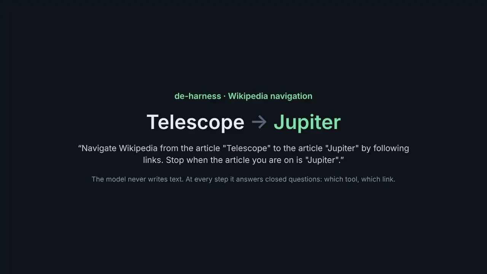
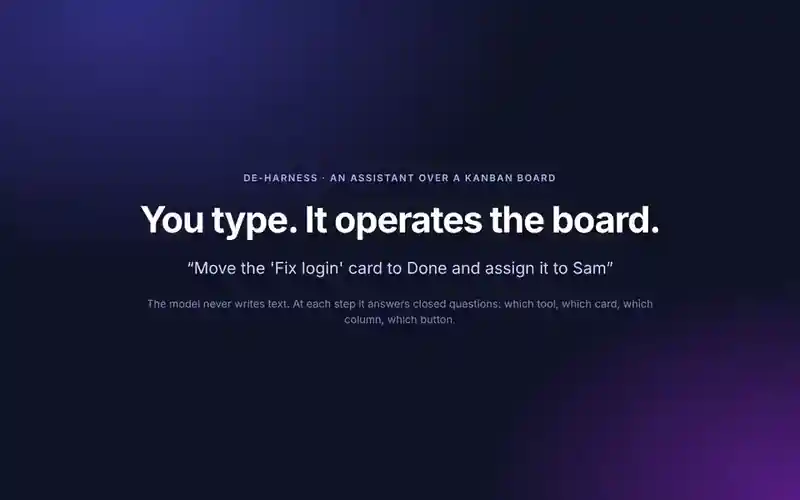
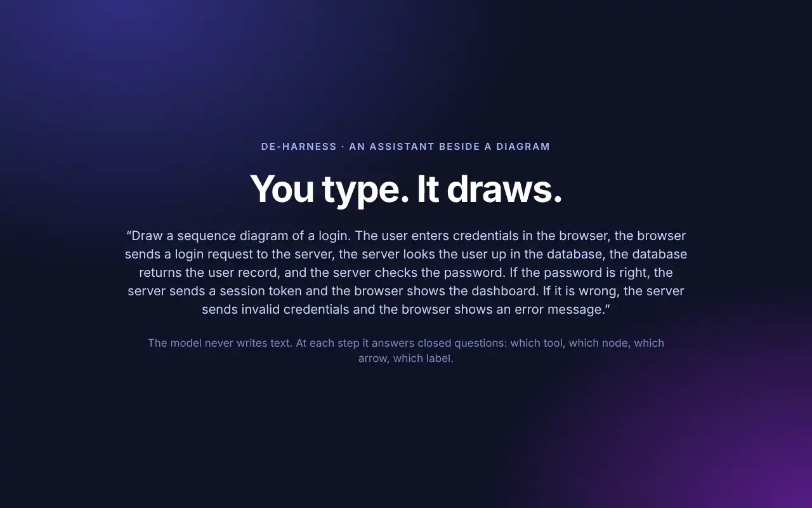

# de-harness

A harness for decision models. The agent has tools; the model (Jev by default) is used only to call them, one
question per tool name and per parameter. See `CLAUDE.md` for principles and commands.





*An assistant that lives on the page ([Kanban example](examples/kanban/)): the person types an instruction into the panel, the agent operates the board by sight at full speed (the cards fly to their new places, animated with CSS transitions), and asks back when the instruction leaves something open. Also as [MP4](docs/media/kanban-demo.mp4).*



*An assistant that draws ([Diagram example](examples/diagram/)): the state is the Mermaid text, the agent works at full speed while the diagram animates, and the panel beside it takes instructions in plain English. Also as [MP4](docs/media/diagram-demo.mp4).*

```sh
npm ci
npm run typecheck
npm test            # replay mode, no network
npm run test:live   # live Jev, re-records cassettes
```

## Examples

Each one has a README that says what it shows and how to run it.

- [Rooms](examples/rooms/): the smallest agent, a hall with coloured doors, to see the core loop.
- [Pizza](examples/pizza/): ordering from a menu, with choices, sets and an optional parameter.
- [Coffee](examples/coffee/): a tool that holds the loop and waits for the customer to answer.
- [Chest](examples/chest/): tools that appear and disappear while the agent runs.
- [Tickets](examples/tickets/): working a support-ticket queue through an HTTP API.
- [Office](examples/office/): thirty tools at once, which makes each step two-phase.
- [Load API](examples/load-api/): a tool that reads an OpenAPI document and adds one tool per endpoint.
- [Graph](examples/graph/): riding a transit map from one station to another.
- [Tree](examples/tree/): filing an item by walking a taxonomy of a few hundred categories.
- [Wikipedia](examples/wikipedia/): getting from one article to another by following links.
- [Screen](examples/screen/): a sign-up form seen only as a picture, with a box around the button to click.
- [Browser](examples/browser/): any web page by address, in a headless Chromium that the agent only sees.
- [Page overlay](examples/page-overlay/): an assistant panel laid over a page: you tell it what to do, and it operates the page behind it.
- [Kanban](examples/kanban/): the same kind of panel beside a Kanban board: it drags cards between columns, opens a card to assign it, and asks you when the instruction does not say who. The panel says nothing until the result.
- [Web page](examples/web-page/): the browser bundle in a plain web page, with `JevModel` pointed at a small proxy on the page's own server that holds the key.
- [Diagram](examples/diagram/): the same panel beside a Mermaid diagram (flowchart or sequence): the diagram text is the state, it draws, edits and asks you what a failure should do, and the page animates every change with CSS transitions.

## Reviewing the model's choices

Left alone, the model does what looks plausible: it does more than it was asked, or stops when the last step matches a phrase of
the instructions. `createAgent({ review })` adds checks, each one extra Jev judgment that code acts on (`src/review/review.ts`):

```ts
createAgent({ model, instructions, tools, review: { end: true, actions: true } })
```

- `end`: before the run ends, ask whether anything doable is left; if so the end is refused and the model chooses again.
- `actions`: before a tool marked `effect: "change"` runs, ask whether `instructions` ask for this very call; if not it does not run
  (the model sees why for one step), and after two refusals in a row the run ends. A `final: true` tool also waits until the
  other parts are done.
- `wording`: ask the tool question as "exactly what `instructions` ask, no more and no less".
- A tool can word its own checks: `summarize` (what this call does), `wanted` (is its work still called for, used by `end`),
  `confirm` (the question to ask before it runs).

It is off by default, so existing recordings stay valid. [`tests/acceptance/behaviour`](tests/acceptance/behaviour/) shows what each check fixes.

## In a web page

`npm run build` writes `dist/`: the compiled sources with types (Node and bundlers), and the browser-safe core
(`src/core.ts`: loop, tools, params, `JevModel`, `ScriptedModel`, `ScriptedInput`, `openApiTools`) as
`de-harness.browser.js`, `de-harness.browser.min.js` (ES modules) and `de-harness.iife.min.js` (a classic script, global
`DeHarness`), about 10 KB gzipped. Bundlers import `de-harness/core`; `de-harness` is the Node entry and adds cassettes,
`StdinInput` and `imageFile`; `de-harness/browser` is the Playwright tools, which run in Node.

Jev refuses requests from browser origins, and a key in page code is public, so a page never calls Jev directly: it
points `JevModel` at its own server, which adds the key (`new JevModel({ baseUrl: location.origin + "/api/jev" })`).
[`examples/web-page/proxy.ts`](examples/web-page/proxy.ts) is that proxy. Once published to npm, jsDelivr and unpkg serve
the files at `https://cdn.jsdelivr.net/npm/de-harness@<version>/dist/de-harness.iife.min.js`.

## How it works

Each step is **one** request to the model: the state document (`instructions`, `state`, `previous_actions`), a Choice
`__tool__` over the available tools, and one question `<tool>.<param>` per parameter of every available tool
(speculative fan-out). Code reads only the chosen tool's answers, runs it, and merges its result into the state.
The model never writes text, so parameters are closed sets (`param.choice` options come from code, often from the state),
a Noul (`boolean | 'unsure'`) or a Score (a level label).

```ts
import { createAgent, defineTool, param, JevModel } from "./src/index.js";

const openDoor = defineTool({
  name: "open_door",
  description: "Opens one of the doors of the current room and walks through it.",
  params: { door: param.choice({ question: "Which door of `state.room.doors` do `instructions` say to go through?", options: (ctx) => ctx.state.room.doors }) },
  run: ({ door }) => ({ state: { room: enter(door) }, summary: `went through the ${door} door` }),
});

const result = await createAgent({ model: new JevModel(), instructions: "Leave through the red door", tools: [openDoor], initialState: { room } }).run();
// result.status: 'ended' | 'step_limit' | 'aborted' | 'error'; result.steps, result.state, result.output, result.events
```

Tools can be added and removed while the agent runs: `ctx.tools.add(tool)` / `ctx.tools.remove(name)` inside a tool (or
`agent.tools` from outside). The registry is read fresh every step, so a change shows from the next request, and each
change emits a `tools_changed` event. A duplicate name and removing the built-in `end` throw (inside a tool: an `error`
slot, registry unchanged). See `examples/chest/`.

### Sub-agents

A tool can run a whole nested agent with `ctx.runAgent(config)` and the loop simply waits for it. The child has its own
tools, instructions and step limit, uses the parent's model unless it brings one, stops when the parent run is aborted,
and its events are written to the parent's trace as `child` events under the step that called it (deeper children nest
further). `delegate` is the ready-made version: the parent *picks* the task from candidates (Jev cannot write it), the
child runs, and its `{ task, status, steps, output }` lands in a state slot, also when the child hit its step limit.

```ts
const helper = delegate({
  tasks: { "Leave the room through the red door": "The helper finds the red door and walks out through it" },
  agent: (task) => ({ instructions: task, tools: rooms.tools, initialState: rooms.initialState, maxSteps: 4 }),
});
```

### Scale: many tools and a context budget

Every request is kept under `contextBudget` tokens (default 48 000, estimated from characters; Jev takes about 64k).
When the one-request fan-out of a step would not fit (say 40 tools with 5 parameters each), the step goes **two-phase**:
first the state and `__tool__` alone, then the state and only the chosen tool's parameter questions (skipped for a tool
without parameters). Each `request` and `answers` event carries a `phase` (`single`, `tool`, `params`, `order_check`),
and `StepRecord.requests` lists them all. A request still over budget loses its oldest `previous_actions`
(a `trimmed` event); with none left the run ends with `status: "error"`, a `budget_exceeded` event and an error naming
the largest part, e.g. `state.page`. Cut big slots and long option lists in code: a Choice takes at most 255 options.

`orderCheck: true` is an opt-in guard against option-order bias: each step also asks `__tool__` with its options reversed,
and a different answer emits `order_disagreement` (the step still goes on with the normal order's answer).
Cassette keys ignore key order, so the reversed request replays the same recording: test the check with `ScriptedModel`.


Try it live: `npm run example:rooms -- "Leave the room through the red door"`.

### Sets, optional values and thresholds

```ts
params: {
  size: param.choice({ question: "Which size from `state.menu.sizes` do `instructions` order?", options: ["small", "medium", "large"] }),
  // one Noul per member (`{}` is the member); the value is the members at or above the yes threshold
  toppings: param.set({ question: "Do `instructions` ask for {} on the pizza?", members: ["mushrooms", "olives", "basil"] }),
  // one extra Noul asks whether the value is stated at all; `undefined` unless it is
  delivery_time: param.choice({ question: "Which slot do `instructions` ask for?", options: slots, optional: { stated: "Do `instructions` say when to deliver?" } }),
  // thresholds per parameter (default yes 0.7 / no 0.3): `true`, `false` or 'unsure'
  gift: param.noul({ question: "Is it a gift?", thresholds: { yes: 0.6, no: 0.4 } }),
}
```

`members` can be a function of the state. 'unsure' never counts as a member or as stated; the raw probabilities are in
`ctx.answers` (`toppings[olives]`, `delivery_time?stated`) for code that wants another rule. Try it:
`npm run example:pizza -- "A large pizza with mushrooms and olives, deliver at 7pm"`.

### Images and boxes

A tool can put a picture into the state with `image(pngOrJpegBytes)` (PNG 280-1568 px per side). The model sees it wherever a question names the slot by path, and requests that carry images are sent with `TypeSafe-Danger-Zone-Images: true`. `param.box({ question, image })` asks Jev where something is (a Box) and, in the same request, whether it is there at all (a companion Noul, `<param>?present` in `ctx.answers`); the tool receives `{ top, bottom, left, right }` as fractions of the image, or `null` when the Noul says the target is absent. Box answers are approximate: compare overlap, not exact edges. Box requests always go to Jev 1.14 or later. Try it: `npm run example:screen -- "Click the Submit button" --out proof.png` (`HARNESS_CASSETTE=replay` uses the recordings).

### A browser as the state

`BrowserSession` (a headless Chromium through Playwright) and `browserTools(session, options)` live in their own module, imported from `src/browser/index.js` (`de-harness/browser`; Playwright stays an optional peer dependency and the core never loads it). They let an agent use a web page that it
only *sees*: every tool that changes the page puts a fresh screenshot into `state.screen` and `{ url, title, scroll }` into
`state.page`. The model points with Boxes and chooses from candidates that code supplies; nothing is generated.

```ts
const browser = await BrowserSession.launch({ allowedHosts: ["shop.example"] });   // 1280x800 viewport, headless
await browser.goto("https://shop.example/");
const result = await createAgent({
  model: new JevModel(),
  instructions: "Find the red mug and open it",
  tools: browserTools(browser, { urls: { "https://shop.example/cart": "the cart" }, texts: ["mug"] }),
  initialState: await browser.snapshot(),      // { screen: image, page: { url, title, scroll } }
}).run();
await browser.text();                          // verify in code: the page's text, never the model's job
await browser.close();
```

| Tool | The model decides | Code decides |
| - | - | - |
| `click(target)` | the Box around the element to click, or that it is not in the screenshot | the click point: the box's centre in viewport pixels (screenshots are viewport-sized at scale 1), moved onto the pressable element that fills most of the box when the centre is on a gap; a box smaller than 48 px, or with nothing pressable in it, is first asked again on a 3x enlarged picture of the part around it (`zoom`), because Jev's finest box is about 13 x 8 px; with `scrollToFind`, a target that is not in the screenshot scrolls down one step instead of doing nothing |
| `hover(target)` | the Box of the element to point the mouse at (menus that open on hover) | only offered with `hover: true`; the pointer goes to the box's point (as for `click`) and the page settles; with `hover: "or-click"` a hover that opened nothing is followed by a click on the same point (menus that open when pressed) |
| `scroll(direction)` | `down` / `up` / `top` / `bottom` | only the directions that move the page are offered (from `state.page.scroll`); gone on a page that fits one screen; steps are 80% of a viewport |
| `type_text(text)` | one of `texts` (candidates), typed into the focused field | reports "typed nothing" when no field is focused; the tool only exists when `texts` is given |
| `press_key(key)` | one of `keys` (default Enter, Tab, Escape) | |
| `navigate(url)` | one of `urls` (candidates) | the tool only exists when `urls` is given; it is the only one offered before a first page is open |
| `go_back` | | goes back one page in the browser history and the page settles; reports "no previous page" when there is none |

For verification and use-case code: `browser.text()` (whole page), `browser.visibleText()` (what is in the viewport right now),
`browser.boxOf(selector)` (the Box a perfect answer would be), `browser.textIn(box, grow?)` (the characters the page shows inside a Box: the model points at a price, code reads it), `browser.evaluate(fn, arg)`, `browser.screenshot()` (what the model sees; `{ everything: true }` keeps in what `hide` / `hideFromModel` hides), `browser.info()`.
The no-change guard (a tool that changed nothing three times in a row is not offered) does not count what the pointer lit up (a hover colour, an underline) as a change. Clicks that open a new tab move the agent to it, dialogs are dismissed, and `allowedHosts` aborts every request to any other host
(an address outside it fails `navigate` with an error and a click on such a link leaves the page where it was). Question wording is in
one place (`src/browser/tools.ts`) and can be replaced per tool with `questions`. Playwright is an optional peer dependency:
`npm i -D playwright && npx playwright install chromium`; in the cloud sandbox Chromium already goes through the egress proxy.
`npm run example:browser -- --url <address> "<what to do>"` runs it live. Tests: `tests/acceptance/browser/` against a site on
loopback (`tests/support/browser-site.ts`, bundled fonts so screenshots are stable); `npm test` replays Jev from cassettes and runs
the real browser, so CI installs Chromium.

An assistant that lives *on* the page (`PageOverlay`, `src/browser/overlay.ts`) puts a chat panel over it: the person types an instruction there, the agent operates the page behind it, and the panel shows the steps, the questions (`overlay.input` is an `InputProvider`, so `ctx.input.ask` holds the loop until the person answers in the panel) and the result. The panel is hidden from every screenshot and zoom the model sees (`hide` / `hideFromModel` on the session), lets the pointer through to the page while the agent works, and keeps its transcript across navigations. See [examples/page-overlay](examples/page-overlay/).

| Where | What |
| - | - |
| `src/model/` | `DecisionModel`, `JevModel` (pinned `jev-1.14.0`), `CassetteModel` / `cassetteFetch` (record/replay), `ScriptedModel` |
| `src/tools/` | `defineTool`, `param.*`, `ToolRegistry`, built-in `end`, `delegate` |
| `src/openapi/` | `openApiTools(spec, { baseUrl })`: one tool per operation of an OpenAPI 3 document, parameters mapped to Choice / Noul / Set, ids taken from earlier list responses |
| `src/questions/` | the question map for a step and answer parsing (the `__tool__` wording lives here) |
| `src/state/` | the state document, slot merging, previous-actions window |
| `src/loop/` | `createAgent(config).run()` |
| `src/input/` | `ctx.input.ask` holds the loop until an `InputProvider` replies: `StdinInput` (terminal), `ScriptedInput` (tests) |
| `src/events/` | typed events and the JSONL trace |
| `src/budget/` | token estimate, the context budget, previous-actions trimming |
| `examples/rooms/`, `examples/pizza/` | the example domains |
| `examples/coffee/` | a tool that asks the customer and waits (`npm run example:coffee`) |
| `examples/tickets/` | stateful API operations: an in-process support-ticket API and the tools that work its queue (`npm run example:tickets`) |
| `examples/load-api/` | a tool that loads tools: `load_api` reads an OpenAPI document, adds one tool per endpoint and removes itself (`npm run example:load-api`) |
| `examples/office/` | thirty tools, the many-tools domain |
| `examples/screen/` | a form seen as a picture: `click(target)` with a Box (fixtures drawn by code, `npm run example:screen:fixtures`) |
| `src/browser/` | `BrowserSession` (headless Chromium, screenshots as state, box to click) and `browserTools` (`click`, `scroll`, `type_text`, `press_key`, `navigate`, `go_back`; a tool that changed nothing three times in a row is no longer offered; `pageText: false` leaves the address and title out of the state) |
| `src/browser/overlay.ts` | `PageOverlay`: the assistant panel over a page (`install`, `say`, `working`, `nextInstruction`, `input`), hidden from the model's screenshots |
| `examples/kanban/` | an assistant panel beside an animated Kanban board (drag and drop, card dialog), with the demo that renders the README media (`npm run example:kanban`, `npm run example:kanban:demo`) |
| `examples/diagram/` | an assistant panel beside a Mermaid diagram: the Mermaid text is the state (no screenshots), tools come and go with what the diagram holds, labels are chosen from candidates, an animated page, with the demo that renders the README media (`npm run example:diagram`, `npm run example:diagram:demo`) |
| `examples/page-overlay/` | an assistant panel over a checkout page that fills in a form, asks a question and places the order (`npm run example:page-overlay`) |
| `examples/browser/` | any page by address: `npm run example:browser -- --url <address> "<what to do>"` |
| `examples/wikipedia/` | navigating Wikipedia by following links (`open_link`, `go_back`, `end`) |

## Example: Wikipedia navigation

*The animation at the top of this page: Telescope to Jupiter in four steps, on the real Wikipedia pages (revisions pinned at the snapshot). At each step the links the agent may follow are boxed and the one it chose is circled, with the tool call underneath. Also as [MP4](docs/media/wikipedia-demo.mp4). Made from a recorded run by `npm run example:wikipedia:demo` (needs network access to Wikipedia, Chromium and ffmpeg; screenshots show Wikipedia, CC BY-SA 4.0).*

`npm run example:wikipedia -- --from "Alan Turing" --to "Enigma machine"` walks from one article to another by following
links and prints the path. `open_link(link)` offers the links of the article body (references, info boxes, navboxes,
other namespaces and redlinks are left out in code, and the list is cut to a budget), keyed by article title and
described by their anchor text; `go_back` returns to the previous article and never offers the abandoned one again.
Articles are fetched as they were at a fixed snapshot (`SNAPSHOT` in `examples/wikipedia/client.ts`), so a recording
never goes stale. Wikipedia rate-limits shared addresses: the live run waits as asked and keeps what is already recorded.
