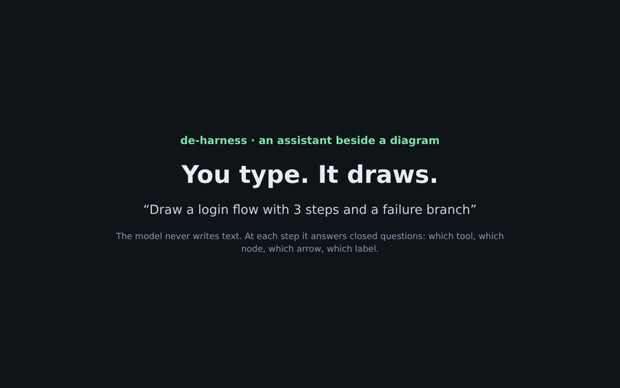

# diagram

An assistant that draws diagrams: a chat panel beside a small diagram studio. You type "Draw a login flow with 3 steps and a failure branch"; the agent builds a Mermaid flowchart one tool call at a time, and the drawing and the Mermaid source beside it change after each step.



**Shows:** the page-overlay pattern ([page-overlay](../page-overlay/), [kanban](../kanban/)) on an agent whose **state is a document**:

- the state is the **Mermaid text** (`state.diagram`) and a picture of what Mermaid drew from it (`state.screen`). Every tool reads the text, changes it and puts the new text and the new picture into the state, so every tool result is the whole current diagram. The page (`diagram-site.ts`, self-hosted on loopback, with Mermaid served from `node_modules`) draws the text it is given and shows it in the pane beside the drawing; a run is checked against that text and against what Mermaid drew from it (the labels of its nodes and arrows, read from the page), never against what the model said;
- the tools are `add_node`, `remove_node`, `rename_node`, `connect`, `disconnect`, `relabel_edge`, `ask_user` and `end`, and they **come and go with the diagram**: nothing can be removed, renamed or connected before there are nodes (and two are needed to connect), nothing disconnected or relabelled before there are arrows, and `connect` offers only the arrows that are not drawn yet;
- Jev cannot write, so every label is **chosen**: from a catalog of common steps (`STEPS`), a catalog of arrow labels (`ARROWS`) and the texts in quotes in the instruction (`Rename 'Build image' to 'Package app'`). Code builds the text, so a node id or a quote can never come out wrong. The lines in the panel are written by code from what the diagram did (`Added the step "Check password"`, `Done: added "Build image", 2 new arrows. The diagram has 4 steps and 4 arrows.`);
- `end` is offered only after a yes/no judgment of the new diagram says it is what the instruction asked for (number of steps, order, the branch, the renames, nothing left over);
- when the instruction leaves something open ("ask me where a failure should lead") a yes/no judgment says so, code asks in the panel, and the loop **holds** until the person answers there. The answer (`state.user_reply`) is what the next steps and the final judgment follow. Only a clear yes asks.

```sh
npm run example:diagram -- [--scenario login-flow|ask-failure|insert-step|tidy] [--runs 1]   # a scripted person types into the panel, headless
npm run example:diagram -- --headed                                                          # you type into the panel yourself (needs a display)
npm run example:diagram:demo -- [--out docs/media]                                           # renders the README video (MP4, WebM) and animated PNG
```

The scenarios: `login-flow` ("Draw a login flow with 3 steps and a failure branch", from nothing), `ask-failure` (the same, "and ask me where a failure should lead"; the scripted person answers "Back to the first step", so an arrow leads back), `insert-step` (on a diagram of three steps: "Add a 'Build image' step between 'Run tests' and 'Deploy'", which takes `add_node`, two `connect`s and a `disconnect`) and `tidy` (on a diagram of five steps: "Rename 'Build image' to 'Package app', call the 'Pass' arrow 'Green', and remove the 'Notify team' step"). A run exits 0 only if the Mermaid text has the structure the scenario asks for: a drawing from nothing is one connected flow with a branch and a failure step (or a way back); an edit is exactly the old diagram with the asked changes and nothing else.

The demo replays the recorded runs of `login-flow`, `tidy` and `ask-failure` (no key, no network) in a Chromium that records the page, types the instruction letter by letter, slows the model down and captions each step with the tool the model chose and what it chose for each parameter. The captions are drawn into an element that is hidden from the model's pictures, so the replay still matches the recordings. `--live` asks Jev instead.

**Needs:** Jev: `TYPESAFE_API_KEY` in the environment (the cloud proxy supplies it in cloud sessions) and Chromium (`npm ci`, `npx playwright install chromium`). The demo also needs ffmpeg. `--headed` needs a display. The page is on loopback; no other network.

**Files:** `graph.ts` (the diagram as Mermaid text: read it, change it, write it), `diagram-site.ts` (the page), `assistant.ts` (tools, candidates, questions, the loop behind the panel), `run.ts` (a scripted person, scenarios, checks), `main.ts` (runner), `demo.ts` (video and animated PNG).
**Acceptance tests:** `tests/acceptance/diagram/`: `mechanics.test.ts` (the tools and the page, with a scripted model) and `assistant.test.ts` (Jev, replayed from `tests/cassettes/diagram`).
