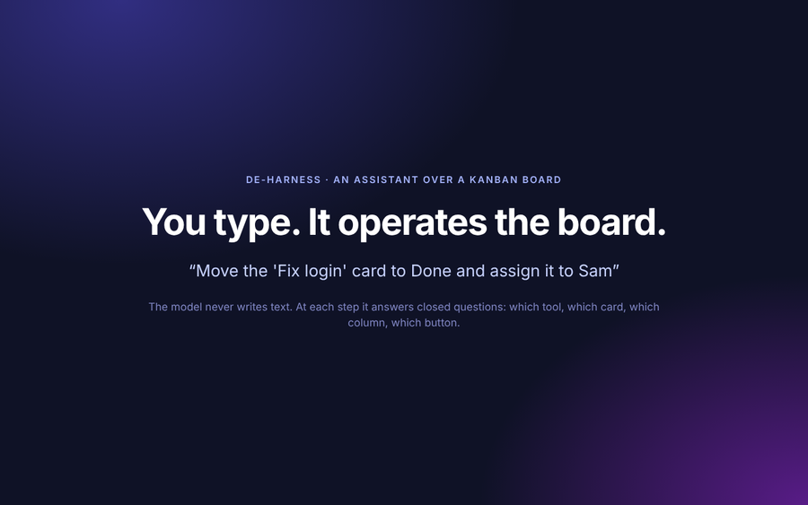

# kanban

An assistant that lives next to a Kanban board: a chat panel beside a small board (To Do, Doing, Done). You type "Move the 'Fix login' card to Done and assign it to Sam"; the agent operates the board by sight, and the panel shows each step and the result.



**Shows:** the page-overlay pattern (`PageOverlay`, see [page-overlay](../page-overlay/)) on an app with real interaction, not a form:

- the board is **self-hosted** (`kanban-site.ts`, in memory on loopback): cards move by **drag and drop** (press, move, let go) or from the card's **dialog** (click a card: its column, its assignee, Close), and the server holds the truth, so a run is checked against the server, never against what the model said;
- the agent has `click` (a Box), `drag` (two Boxes: which card, which column; `BrowserSession.dragBox`), `ask_user` and `end`. It sees only a screenshot of the board without the panel; Jev cannot write, so what it asks comes from a list of questions (`GAPS`), and the lines in the panel are written by code from what the board did (`"Fix login" moved from To Do to Done, assigned to Sam`);
- when the instruction leaves something open ("ask me who to assign it to") a yes/no judgment says so, code asks in the panel, and the loop **holds** until the person answers there. Only a clear yes asks: asking what the person already said is worse than a run that comes out wrong, which the board shows;
- `end` is offered only after a yes/no judgment of the new screenshot says the card is where and as asked and no dialog is open.

```sh
npm run example:kanban -- [--scenario move-assign|ask-assignee|move-only] [--runs 1]   # a scripted person types into the panel, headless
npm run example:kanban -- --headed                                                       # you type into the panel yourself (needs a display)
npm run example:kanban:demo -- [--out docs/media]                                        # renders the README video (MP4, WebM) and animated PNG
```

The scenarios: `move-assign` ("Move the 'Fix login' card to Done and assign it to Sam"), `ask-assignee` ("Move the 'Update docs' card to Doing and ask me who to assign it to"; the scripted person answers "Priya") and `move-only` ("Move the 'Review pricing page' card to Done": no question, nobody reassigned). A run exits 0 only if the board is the start with exactly that card changed.

The demo replays the recorded runs of `move-assign` and `ask-assignee` (no key, no network) in a Chromium that records the page, types the instruction letter by letter, slows the model down and draws a pointer and the Boxes it chose into an element that is hidden from the model's pictures, so the replay still matches the recordings. `--live` asks Jev instead.

**Needs:** Jev: `TYPESAFE_API_KEY` in the environment (the cloud proxy supplies it in cloud sessions) and Chromium (`npm ci`, `npx playwright install chromium`). The demo also needs ffmpeg. `--headed` needs a display. The board is on loopback; no other network.

**Files:** `kanban-site.ts` (the board, bundled fonts), `assistant.ts` (tools, questions, the loop behind the panel), `run.ts` (a scripted person, scenarios, checks), `main.ts` (runner), `demo.ts` (video and animated PNG).
**Acceptance tests:** `tests/acceptance/kanban/`: `mechanics.test.ts` (drag, dialog, the panel kept out of the model's picture, with a scripted model) and `assistant.test.ts` (Jev, replayed from `tests/cassettes/kanban`).
